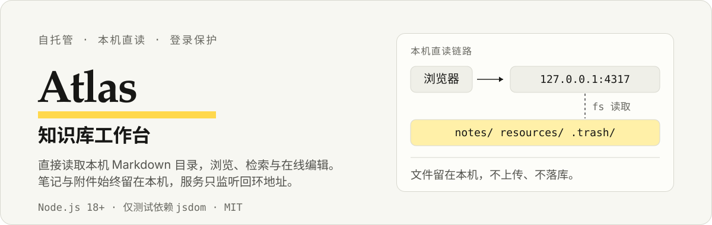

# Atlas 知识库工作台

自托管的知识库工作台。服务实时读取所在机器的笔记目录，支持本机运行，或在服务器运行并与本机双向同步；主库页面与接口需要登录，单篇分享可免登录访问。

<p align="center">
  
</p>

## 特性

- **实时读取**：直接读本机 `notes/` 与 `resources/`，外部编辑、原子替换、新增、改名、删除在下次请求即生效，不依赖同步机制
- **在线编辑**：浏览器内改 Markdown 原文，保存走临时文件 + 原子替换；基于文档版本的乐观并发控制，多窗口同时编辑不会互相覆盖
- **安全删除**：不进回收站，移入主库 `.trash/` 并保留目录结构，可随时找回
- **免登录分享**：单篇文档生成短链接，访客可看该文档及其引用的媒体，其余内容仍需登录
- **游客示例**：登录页可直接进入游客会话，只读浏览一份内置示例内容，与本机主库完全隔离
- **图片与视频**：支持 Markdown、HTML、`[[双链]]` 三种写法，含本地视频 Range 分段播放与封面
- **移动端**：独立窄屏布局，含侧栏抽屉、日历、底部 tab 与边缘滑动返回
- **PWA**：提供 `apple-touch-icon`，可添加到 iOS 主屏
- **只读 MCP**：多个 AI Agent 共用知识库，支持目录授权、关键词检索、章节分页读取和引用附件访问

## 与其他方案的区别

- **不建索引**：每次请求都从文件系统读取，进程内只按修改时间做缓存，没有需要同步的持久索引
- **文件式存储**：笔记保持 Markdown 与原始附件格式，本机可继续使用 iCloud、Obsidian 或 Git；服务器部署可另行配置双向同步
- **回环监听**：服务只监听 `127.0.0.1`，需要外部访问时接入隧道或反向代理

## 快速开始

推荐 Node.js 24。网页服务使用 `jsdom` 解析文档，独立 MCP 服务另使用官方 MCP SDK 和 `zod`；运行前需安装依赖。

```sh
npm install
npm start
```

打开 `http://127.0.0.1:4317/login`。首次进入需创建唯一管理员，凭据写在 `.local/setup-token`，创建完成后该文件自动删除。密码至少 12 位，只存哈希。

登录页也可直接选「游客访问」，不需要账号即可浏览一份只读的内置示例。会话有效期：管理员 12 小时，游客 2 小时（游客会话总数上限 64）；服务重启后需重新登录。忘记密码时停止服务、移走 `.local/admin.json` 后重启，重新走初始化流程。

## 配置

全部通过环境变量，均为可选：

| 变量 | 默认值 | 说明 |
|---|---|---|
| `PORT` | `4317` | 监听端口，仅绑定 `127.0.0.1` |
| `ATLAS_VAULT` | 硬编码的本机路径 | 笔记主库目录，**部署到其他机器时必须显式设置** |
| `ATLAS_STATE_DIR` | `<项目>/.local` | 凭据、分享记录与日志的存放目录 |
| `ATLAS_PUBLIC_URL` | 无 | 对外访问地址。公网部署必设，用于校验登录来源与签发 Secure Cookie |

`.local/` 已在 `.gitignore` 中，不要提交或公开。

## 部署

服务只监听回环地址，对外暴露需自行接入反向代理或隧道。仓库提供以下部署脚本与模板：

| 文件 | 用途 |
|---|---|
| `install-local.py` | 将服务注册为用户级 LaunchAgent（macOS） |
| `install-cloudflare.py` | 将 Cloudflare Tunnel 注册为独立 LaunchAgent |
| `install-tunnel.py` | SSH 反向隧道备用方案 |
| `Caddyfile` | Caddy 反向代理示例（HTTPS + HSTS） |
| `atlas.service`、`atlas.env.example` | Linux 服务与环境变量模板 |
| `atlas-sync.service` | 独立双向同步服务模板 |
| `Caddyfile.server` | 服务器本地 Atlas 的 HTTPS 代理模板 |

服务器部署与双向同步见 [Linux 迁移说明](docs/linux-migration.md)。目标入口为 `https://note.lrwei91.cn`；中国大陆服务器的公网网站须先满足备案与接入条件。备案完成前可通过 SSH 转发私有访问，不切换原公网入口。

以 Cloudflare Tunnel 为例，不需要云服务器或本机入站端口：

```text
浏览器 → Cloudflare HTTPS → 加密 Tunnel → 127.0.0.1:4317 → 本机笔记目录
```

需要本机已装 `cloudflared`，隧道配置与凭据就绪后运行脚本，并确保 `ATLAS_PUBLIC_URL` 与隧道 ingress 一致。注意服务只在本机运行且保持唤醒，主机休眠或断网时访问不可用。

参考：[Cloudflare Tunnel 本地管理隧道文档](https://developers.cloudflare.com/tunnel/features/locally-managed-tunnels/create-local-tunnel/)。

## 分享

新分享统一由 Atlas 自身提供，链接为 `<ATLAS_PUBLIC_URL>/s/<随机标识>`，不再导出到 GitHub。分享内容随文档更新，只开放该文档引用的附件；取消分享或删除文档后链接立即失效。旧分享已撤销，不保留 GitHub 重定向、旧路径或旧标识兼容。详见 [服务器分享](docs/server-sharing.md)。

## 知识库 MCP

MCP 与网页服务独立运行，共用文档读取与搜索实现。各 Agent 使用独立 Bearer Token，可按目录限制只读权限；支持 `list_notes`、`search_notes`、`read_note`、`get_attachment`。服务端点为 `POST /note`，部署与客户端配置见 [MCP 接入说明](docs/knowledge-mcp.md)。正式凭据不进入仓库。

## API

以下为网页服务 API：主库接口需要会话，且写操作校验请求来源；独立 MCP 服务使用 Bearer 认证。

| 方法 | 路径 | 说明 |
|---|---|---|
| `GET` | `/api/tree` | 分类目录树 |
| `GET` | `/api/cards` | 卡片列表，支持 `dir` 筛选 |
| `GET` | `/api/search` | 全文检索，参数 `q` |
| `GET` | `/api/doc` | 读取文档，参数 `path`，返回 `version` |
| `POST` | `/api/doc` | 新建文档，仅 `.md`，同名自动加时间戳 |
| `PUT` | `/api/doc` | 保存文档，需同时提交 `content` 与 `version` |
| `DELETE` | `/api/doc` | 移入 `.trash/` |
| `GET` | `/api/cover` | 文档内嵌封面，带 ETag / 304 校验 |
| `POST` | `/api/share` | 创建或取消分享 |

登录与会话接口：`GET /auth/status`，`POST /auth/login`、`/auth/setup`、`/auth/guest`、`/auth/logout`，统一校验请求来源。

`PUT /api/doc` 的版本校验：缺少 `version` 返回 `428`，文档已被外部修改返回 `409`（保留浏览器草稿，需手动合并）。

## 测试

```sh
npm test              # 功能回归，使用临时笔记库与临时账号，不触碰真实数据
npm run test:performance   # 性能与实时更新回归，输出预热后 9 次请求的中位耗时
```

回归覆盖首次初始化、会话与限速、路径穿越与符号链接隔离、附件权限、编辑版本冲突、分享范围与撤销、游客只读隔离、UTF-8 分块传输、移动端手势与缩放策略、页面缓存复用与失效。性能测试使用合成库（502篇笔记、500 张图片），其结果不代表真实设备表现。

列表在当前页面内缓存最多 8 个视图、合计 4000 张卡片（当前视图始终保留），切换 tab 会复用卡片、封面和滚动位置。文档修改后缓存失效；刷新按钮会重新读取外部文件变化。列表与目录树的重复请求合并，数据未变化时使用 ETag / 304 校验。缓存不写入本地持久存储，退出或会话失效后清空。

浏览器模拟不能替代真机验收：缩放拦截、手势返回、辅助功能需在真实 iOS Safari 上确认。

## 数据与安全

- 网页主库的笔记、搜索、附件和页面均需登录；单篇分享仅开放所选文档及其引用附件，MCP 使用独立只读凭据
- 写入与删除接口要求已登录会话并校验 `Origin`
- 游客会话是封闭沙箱：只读、只能访问内置示例，写操作与主库附件一律拒绝
- 分享链接使用 128 位随机熵，仅暴露该文档内引用的媒体；已被访客保存的内容无法撤回
- 登录限速 10 次 / 15 分钟；游客入口独立限速 20 次 / 15 分钟，双方会话上限互不影响
- 路径穿越与软链越界按realpath 双重校验拦截

## 许可

[MIT](LICENSE)。`public/vendor/` 下的第三方库保留各自许可证。
